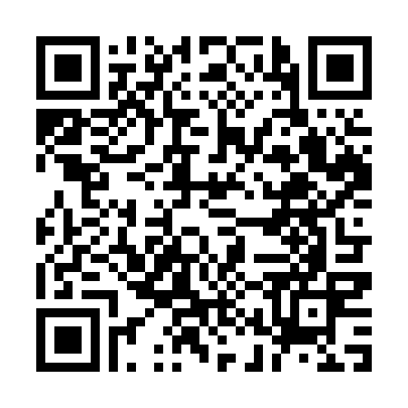
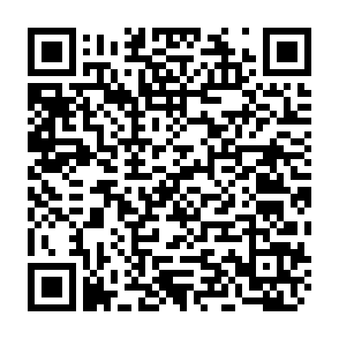
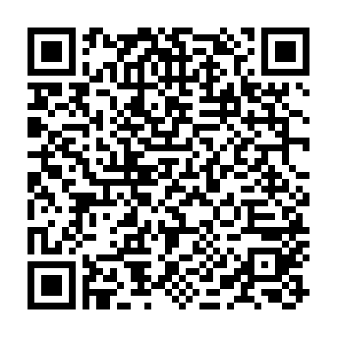
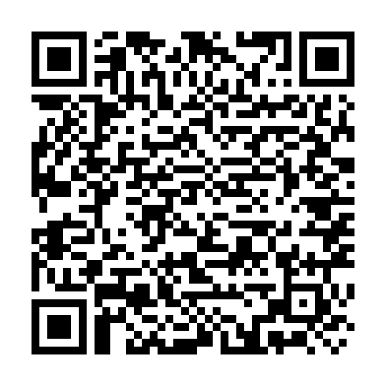

# Jan Brůna

I'm interested in privacy and security. In my free time, I work on [hryziko](https://hryziko.dev).
Questions about hryziko? Join the [discord](https://discord.gg/a9nH6Z5Esx).

---

### Things I Recommend

**Privacy and Security:**

- [GrapheneOS](https://grapheneos.org/)
- [PrivSec](https://privsec.dev/)
- [secureblue](https://secureblue.dev/)
- [Chromium Hardening Guide](https://rknf404.github.io/chromium-hardening-guide/)

<b>Support options</b>

If you want to support my work, **Monero** is preferred:

`8BfbWNjUNKV1CqLGnR9gdVBwX5XJX9xgu1HBSEMqhWa8hmnJgFfj4MsHFzuRxaEsu1XajzBY5pkupRockHRCszxB5VJxEFX`

<small>Other options (ZEC, LTC, BTC)</small>

**ZEC (Shielded):**

`u1mzqjm2f8kh28gsatckz4cm0jf72yu66v0l5nd87mjalck7v4pup2q20qun3m76lhlz6526nkk5r42eu2lxkkv97tn5xnpvse7v7fuk3t`

**LTC (MWEB):**

`ltcmweb1qqveslkhhgdgvu34senwtwp906m96u998kywe0q5ymfv5hy78q0equqnf9gssn6d0v9z6j0ht2r8zx66axsfq98sayr9xa5dv7z4m9wkway7ga5ql`

**BTC (Silent Payments):**

`sp1qqdhuxuem770z0sckqhdj4g3sd3njjy53hfluqsnnt2yyjy4tmrsn7qa2gh9mmlkqdy0t9up30zy3xx5rrgcd4gex0m3dcegfm2n5xsa49g5klnm9`

